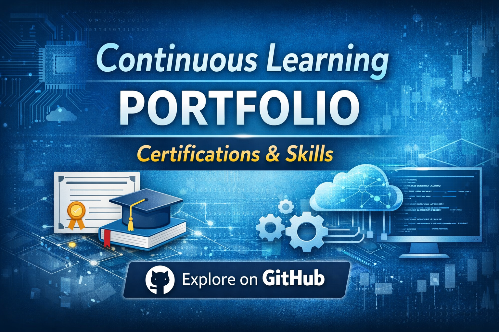

# Professional Development & Course Certificates

This repository contains my curated collection of **140+ course certificates** earned through online learning platforms, professional training providers, and technical education programs.

It is designed to support my **LinkedIn profile, CV, and professional networking presence** by presenting a structured record of continuous learning across software engineering, cloud, AI, SAP, embedded systems, project management, and professional skills.

## Collection Snapshot

- **140+ certificates** in one public archive
- Coverage across **technical, business, and professional development** topics
- Learning evidence from platforms including **LinkedIn Learning, Pluralsight, Udemy, Coursera, Alison, Educative, Eduonix, and Michael Management**
- Organized by topic for easier browsing by recruiters, hiring managers, and collaborators

## Why this repository exists

I use this repository as a **professional learning portfolio**.

It helps me document:
- sustained commitment to continuous learning
- topic breadth across multiple technical domains
- progression from foundations to more advanced subjects
- role-relevant upskilling that complements projects and hands-on experience

For recruiters and hiring managers, this repository serves as a verifiable companion resource for my **CV, LinkedIn profile, and job applications**.

## Learning Areas

### Artificial Intelligence
Focus on practical AI adoption, prompt engineering, generative AI, agentic workflows, responsible AI, and developer productivity with AI tools.

Representative courses include:
- Agentic AI Fundamentals: Architectures, Frameworks, and Applications
- OpenAI ChatGPT: Creating Custom GPTs
- ChatGPT: Publishing GPTs on the GPT Store
- Secure Generative AI and LLM Deployment
- Claude Code 4: Agentic Coding for Professional Developers
- Pair Programming with AI
- GitHub Copilot for the IT Operations Professional

### Cloud & DevOps
Focus on cloud architecture, Azure, Cloud Foundry, Git, GitLab, DevOps workflows, CI/CD, and containerization fundamentals.

Representative courses include:
- Cloud Architecture: Core Concepts
- Cloud Architecture: Advanced Concepts
- Microsoft Azure for Developers
- Azure DevOps for Beginners
- Continuous Integration and Continuous Delivery with GitLab
- Getting Started with Git
- Docker for Dummies: The Complete Absolute Beginner's Guide

### Software Development
Focus on programming languages, desktop development, frameworks, APIs, and software engineering foundations.

Representative course groups include:
- **C / C++ / Qt**: pointers, file systems, socket programming, IPC, Qt widgets, GUI development
- **C# / .NET**: ASP.NET, collections, interfaces, LINQ, XAML, WPF, Visual Studio
- **Java / Python / Web**: Java essentials, Django, Python requests, JavaScript, Node.js, React, Laravel, PHP, HTML, CSS, jQuery
- **Web Services & APIs**: API fundamentals, REST API design, web services foundations

### Embedded Systems & Linux
Focus on embedded C, STM32 development, HAL drivers, RTOS/FreeRTOS, CAN bus, Linux usage, shell fundamentals, and command-line proficiency.

Representative courses include:
- Embedded Systems Bare-Metal Programming Ground Up (STM32)
- Embedded Systems STM32 HAL APIs Driver Development
- FreeRTOS From Ground Up on ARM Processors
- Microcontroller Embedded C Programming
- Mastering STM32CubeMX 5 and CubeIDE
- Getting Started with Linux
- Master the Linux Command Line

### SAP Ecosystem
Focus on SAP S/4HANA, ABAP, SAP BTP, ERP fundamentals, MM, SD, procurement, reporting, configuration, and implementation methodology.

Representative courses include:
- SAP Professional Fundamentals
- SAP BTP for Beginners
- Introduction to ABAP 7.4 in S/4HANA
- SAP ABAP Programming for Beginners
- SAP ERP Essential Training
- SAP Financials Essential Training
- SAP Materials Management Overview
- SAP Procure to Pay Process Flow
- SAP S/4HANA: Basic Navigation and Reporting Skills

### Data, Reporting & Business Tools
Focus on SQL Server, SSMS, reporting, business intelligence, Excel macros, VBA, and SharePoint.

Representative courses include:
- Introduction to SQL Server
- SQL Server Management Studio by Example
- Advanced SQL Server Reporting Services
- Learning Microsoft Business Intelligence Stack
- Excel VBA: Managing Files and Data
- SharePoint Online Essential Training: The Basics

### Project Management & Professional Skills
Focus on Agile, Scrum, Kanban, product ownership, process improvement, teamwork, communication, leadership, productivity, and career development.

Representative courses include:
- Agile Foundations
- Scrum: The Basics
- Stay Lean with Kanban
- Agile Product Owner Role Foundations
- Hybrid Project Management: Do What Works
- Process Improvement Foundations
- Developing Executive Presence
- Working on a Cross-Functional Team
- Managing Your Time
- Build Your Career with Michael Lopp

## Selected Highlights

Below are selected certificates that best represent the breadth of this portfolio:

- **Artificial Intelligence** — Agentic AI Fundamentals: Architectures, Frameworks, and Applications  
  [`Artificial Intelligence/Agentic AI Fundamentals Architectures Frameworks and Applications.pdf`](Artificial%20Intelligence/Agentic%20AI%20Fundamentals%20Architectures%20Frameworks%20and%20Applications.pdf)
- **Generative AI / Tooling** — OpenAI ChatGPT: Creating Custom GPTs  
  [`Artificial Intelligence/OpenAI ChatGPT Creating Custom GPTs.pdf`](Artificial%20Intelligence/OpenAI%20ChatGPT%20Creating%20Custom%20GPTs.pdf)
- **AI for Engineering Productivity** — Claude Code 4: Agentic Coding for Professional Developers  
  [`Artificial Intelligence/Claude Code 4 Agentic Coding for Professional Developers.pdf`](Artificial%20Intelligence/Claude%20Code%204%20Agentic%20Coding%20for%20Professional%20Developers.pdf)
- **Cloud / DevOps** — Azure DevOps for Beginners  
  [`Git and DevOps/Azure DevOps for Beginners.pdf`](Git%20and%20DevOps/Azure%20DevOps%20for%20Beginners.pdf)
- **Embedded Systems** — FreeRTOS From Ground Up on ARM Processors  
  [`Microcontroller Programming/FreeRTOS From Ground Up on ARM Processors.pdf`](Microcontroller%20Programming/FreeRTOS%20From%20Ground%20Up%20on%20ARM%20Processors.pdf)
- **Programming** — C# 12: Ultimate Guide - Beginner to Advanced Master Class  
  [`C# language/CSharp 12 - Ultimate Guide - Beginner to Advanced  Master class.pdf`](C%23%20language/CSharp%2012%20-%20Ultimate%20Guide%20-%20Beginner%20to%20Advanced%20%20Master%20class.pdf)
- **Python / Full Stack** — Django 4 and Python Full-Stack Developer Masterclass  
  [`Python language/Django 4 and Python Full-Stack Developer Masterclass.pdf`](Python%20language/Django%204%20and%20Python%20Full-Stack%20Developer%20Masterclass.pdf)
- **SAP** — SAP Professional Fundamentals  
  [`SAP ecosystem/SAP Professional Fundamentals Coursera FHLD5TYMUC3B.pdf`](SAP%20ecosystem/SAP%20Professional%20Fundamentals%20Coursera%20FHLD5TYMUC3B.pdf)
- **Project Management** — Agile Foundations  
  [`Project Management/Agile Foundations.pdf`](Project%20Management/Agile%20Foundations.pdf)
- **Data & Reporting** — Learning Microsoft Business Intelligence Stack  
  [`Excel, VBA and SQL/Learning Microsoft Business Intelligence Stack.pdf`](Excel,%20VBA%20and%20SQL/Learning%20Microsoft%20Business%20Intelligence%20Stack.pdf)

## Full Certificate Archive

The full archive is organized by topic. Each file in the repository corresponds to a certificate or course-completion document.

### Artificial Intelligence
- AI Agents for Everyday Professionals: Simple Automations to Speed Up Your Work (No Code Required)
- AI Agents in Your Browser: Boosting Productivity with Gemini in Chrome
- Agentic AI Fundamentals: Architectures, Frameworks, and Applications
- Artificial Intelligence Essentials: Chatbots
- Artificial Intelligence Essentials: Responsible AI
- Artificial Intelligence Foundations: Thinking Machines
- Big Data in the Age of AI
- Build and Deploy Anywhere with OpenAI GPT-5/Codex
- ChatGPT: Publishing GPTs on the GPT Store
- ChatGPT and IT Certifications
- Claude Code 4: Agentic Coding for Professional Developers
- Claude Code Crash Course: Claude Code in a Day
- Claude Code for Everyday Professionals: Build Productivity Tools with Plain English
- Claude Cowork 7-Day Challenge: Find Practical AI Use Cases That Deliver
- Getting Started on Prompt Engineering
- Google Antigravity Crash Course: Google Antigravity in a Day
- OpenAI ChatGPT: Creating Custom GPTs
- Pair Programming with AI
- RPA, AI, and Cognitive Tech for Leaders
- Secure Generative AI and LLM Deployment
- The IT Ops Sessions: GitHub Copilot for the IT Operations Professional

### Blockchain
- Blockchain Basics

### C Language
- C Data Structures, Pointers, and File Systems
- C Essential Training 2: Flow Control, Arrays, and Exception Handling
- C Essential Training 1: Syntax and Object-Oriented Programming
- C Essential Training 1: The Basics
- C Programming Language Fundamentals
- C Programming: Master the C Language
- Learn Socket Programming Tutorial in C from Scratch
- Learning C
- Linux Inter-Process Communication from Scratch in C

### C# Language
- ASP.NET Essential Training
- Beginning C# Collections
- C# Interfaces and Generics
- C# Fundamentals
- C# 12: Ultimate Guide - Beginner to Advanced Master Class
- C# Interfaces
- Diploma in C Programming
- LINQ with C# Essential Training
- Microsoft XAML 1: Core Concepts
- Microsoft XAML 2: Content and Properties
- Microsoft XAML 3: Type Converters and Resources
- Object-Oriented Programming Fundamentals in C#
- Visual Studio Essential Training 01: Exploring the Visual Studio Ecosystem
- Visual Studio Essential Training 02: Getting Comfortable with the IDE
- Visual Studio Essential Training 03: Exploring Projects and Solutions
- Visual Studio Essential Training 05: Code Editors
- Visual Studio Essential Training 11: Data Tools
- Windows Presentation Foundation 1: Build Dramatic Desktop Applications
- Working with Nulls in C#
- Xamarin.Forms: The Big Picture

### C++ and Qt
- Learn by Example: C++ Programming — 75 Solved Problems
- Learn by Example: C++ Programming
- Qt 5 C++ GUI Development for Beginners: The Fundamentals
- Qt 5 Core for Beginners with C++
- Qt 5 Widgets for Beginners with C++
- Qt 6 Core for Beginners with C++

### Cloud
- Cloud Architecture: Advanced Concepts
- Cloud Architecture: Core Concepts
- Cloud Foundry 6: The Big Picture
- Microsoft Azure for Developers
- Microsoft Fabric Overview: Understanding the Potential

### Excel, VBA and SQL
- Advanced SQL Server Reporting Services
- Excel 2010 Macros
- Excel VBA: Managing Files and Data
- Introduction to SQL Server
- Learning Microsoft Business Intelligence Stack
- Microsoft MTA: Database Administration Fundamentals
- SQL Server Management Studio by Example

### Git and DevOps
- Azure DevOps for Beginners
- Continuous Integration and Continuous Delivery with GitLab
- Docker for Dummies: The Complete Absolute Beginner's Guide
- Getting Started with Git
- Learning GitLab

### Java Language
- Java 8 Essential Training
- Learning Java
- Modern Java: The Big Picture

### Leadership and Self Development
- Build Your Career with Michael Lopp
- Burning Out and How to Deal with It
- Careers in the Game Industry
- Complete Obsidian: Build Your Second Brain with Zettelkasten
- Connecting with Peers in the Workplace
- Developing Executive Presence
- Foundations of the Fourth Industrial Revolution: Industry 4.0
- How to Create Interesting and Meaningful Work
- Humor in the Workplace
- Improving Your Conflict Competence
- Improving Your Memory
- Learning Technology in the Information Age
- Learning to Be Assertive
- Managing Your Personal Investments
- Managing Your Time
- Sales Foundations
- Teamwork Foundations
- The Science of Sales
- Web Development Foundations: Full-Stack vs Front-End
- Working on a Cross-Functional Team

### Linux OS
- Getting Started with Linux
- Getting Started with the Linux Command Line
- Learning Ubuntu Desktop Linux
- Master the Linux Command Line
- Meet the Command Line
- Red Hat Enterprise Linux Shell Fundamentals

### Microcontroller Programming
- An Introduction to the Controller Area Network (CAN) Bus
- Build Your Own Real-Time OS (RTOS) From Ground Up on ARM — Part 1
- Embedded Systems Bare-Metal Programming Ground Up (STM32)
- Embedded Systems STM32 HAL APIs Driver Development
- FreeRTOS From Ground Up on ARM Processors
- Mastering Microcontroller STM32-LTDC LCD-TFT LVGL
- Mastering STM32CubeMX 5 and CubeIDE
- Microcontroller Embedded C Programming

### Mobile Development
- Flutter: The Big Picture

### Networking
- Wireshark Essential Training
- Wireshark Network Troubleshooting

### Operations Management
- Accounting Foundations: Bookkeeping
- Accounting Foundations
- Financial Analysis: Introduction to Business Performance Analysis

### Productivity
- SharePoint Online Essential Training: The Basics

### Project Management
- Advanced Agile: The Team's Mindset
- Agile Foundations
- Agile Product Owner Role Foundations
- Agile Software Development: Extreme Programming
- Agile Software Development: Kanban for Developers
- Agile Software Development: Pair and Mob Programming
- Agile Software Development: Transforming Your Organization
- Agile at Work: Building Your Agile Team
- Agile at Work: Driving Productive Agile Meetings
- Agile at Work: Planning with Agile User Stories
- Azure DevOps for Beginners
- Comparing Agile versus Waterfall Project Management
- Hybrid Project Management: Do What Works
- Learning Gantt Charts
- Process Improvement Foundations
- Project Management: Iterative Methods
- Project Management Simplified
- Project Management: Solving Common Project Problems
- Scrum: The Basics
- Stay Lean with Kanban

### Python Language
- Django 4 and Python Full-Stack Developer Masterclass
- Learn Python Requests
- Python Programmer's Ultimate Guide: Zero to Hero
- Python Quick Start
- Python Quickstart for Experienced Programmers

### SAP Ecosystem
- A Tour of the SAP Cloud Platform
- ABAP Workbench: The Big Picture
- ABAP for SAP Users
- Installing the SAP GUI
- Introduction to ABAP 7.4 in S/4HANA
- Introduction to SAP Activate Implementation Methodology
- Introduction to SAP Configuration
- Learn SAP ABAP Objects
- Learning SAP Human Capital Management
- Learning SAP MM: Materials Management
- Learning SAP Production Planning
- Learning SAP Sales and Distribution (SD) Module
- Microsoft Excel Integration with SAP Using OData
- Planning Basics in SAP
- Reading Data in ABAP with Open SQL
- SAP ABAP: Intro to Editing & Operators
- SAP ABAP Programming for Beginners
- SAP ABAP: Working with Data Basics
- SAP BTP for Beginners
- SAP ERP Essential Training
- SAP Financials Essential Training
- SAP Inventory Management
- SAP Material Master Data
- SAP Materials Management Overview
- SAP Materials Requirements Planning
- SAP Procure to Pay Process Flow
- SAP Professional Fundamentals
- SAP Purchasing
- SAP S/4HANA: Intermediate SAP Skills
- SAP S/4HANA: Basic Navigation
- SAP S/4HANA: Basic Reporting Skills
- SAP S/4HANA: Intermediate Reporting Skills
- SAP S/4HANA: Beyond the Basics
- SAP Sales and Distribution Overview
- The Ultimate SAP S/4HANA Course
- Using ABAP on SAP HANA Cloud Trial Platform

### Web Development Technologies
- HTML Essential Training
- Hands-On JavaScript Project: JSON
- Laravel 9: The Big Picture
- Learning the JavaScript Language
- Making Sense of the CSS Box Model
- Node.js 12: The Big Picture
- PHP: The Big Picture
- React 18: The Big Picture
- jQuery Essential Training

### Web Services and APIs
- API and Web Service Introduction
- Designing RESTful APIs
- Learning REST APIs
- Programming Foundations: Web Services

## Learning Timeline and Focus Areas

### 2014–2016
- Microsoft Excel
- Visual Basic for Applications (VBA)
- SQL
- Dashboards
- Business Intelligence
- Reporting

### 2016–2018
- SQL Server
- SQL Server Management Studio (SSMS)
- T-SQL
- SQL Server Reporting Services (SSRS)

### 2018–2020
- Agile frameworks
- Visual Studio IDE
- C#
- ASP.NET Web Forms
- JavaScript and jQuery
- CSS and HTML
- Windows Presentation Foundation (WPF)
- XAML
- Windows Forms

### 2020–2024
- Linux
- Embedded Linux development
- Bare-metal development
- C and C++
- Qt
- STM32CubeIDE and STM32CubeMX
- LVGL
- RTOS / FreeRTOS
- Docker, GitLab, and CI/CD
- Python

### 2024–2025
- SAP S/4HANA
- ABAP
- SAP Business Technology Platform
- C# refresh and advancement

### 2025–present
- Embedded development
- Artificial intelligence
- Leadership
- Project management

## Online Learning Platforms

- LinkedIn Learning
- Pluralsight
- Udemy
- Coursera
- Alison
- Eduonix
- Educative
- Michael Management

## For Recruiters and Hiring Managers

If you arrived here from my **LinkedIn profile, CV, or application materials**, this repository provides additional evidence of:
- continuous professional development
- self-directed technical learning
- breadth across engineering, enterprise systems, and professional skills
- long-term commitment to staying current with evolving technologies

## Note

These certificates complement practical experience, projects, and applied work. They represent **structured learning and continued development**, rather than standalone proof of proficiency.

## About Me

- **George Calin**
- george.calin [at] gmail.com
- LinkedIn: https://www.linkedin.com/in/cgeorge1978/
